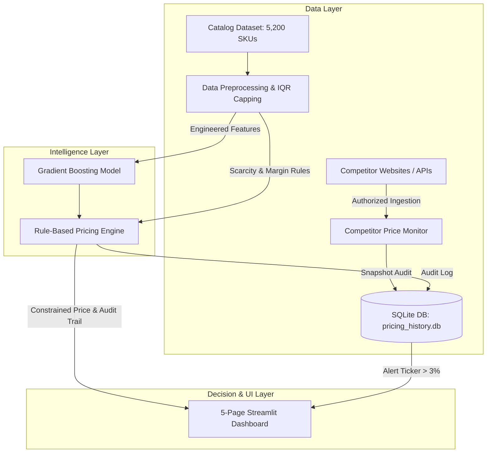

# Real-Time Dynamic Pricing Framework for E-Commerce Platforms Using Live Competitor Scraping Engines

[](https://www.python.org/)
[](https://streamlit.io/)
[](https://scikit-learn.org/)
[](https://pytest.org/)
[](LICENSE)

An enterprise-grade, college-level Data Science and Machine Learning project that optimizes e-commerce product pricing in real time by harmonizing live competitor scraping, inventory scarcity elasticities, non-negotiable profit margin floors, and supervised tree ensembles.

---

## 🌟 Key Highlights & Capabilities

- **🌐 Polite & Compliant Competitor Scraping Engine:** Supports authorized web page extraction via `requests` and `BeautifulSoup4` with `robots.txt` verification, alongside deterministic stochastic market simulation feeds.
- **🛡️ Hard Economic Margin Floors:** Non-negotiable floor rule ($P \ge \text{Cost} \times 1.15$) guarantees that prices never breach a minimum 15% profit margin, preventing race-to-the-bottom losses.
- **⚡ Volatility Dampening:** Limits per-cycle price adjustments to ±15% to preserve brand equity and prevent consumer churn.
- **🤖 High-Accuracy Machine Learning Pipeline:** Benchmarks Linear Regression, Random Forest, and Gradient Boosting Regressors. Champion **Gradient Boosting** delivers **$R^2 = 0.9983$** and **MAE = $6.56$**.
- **📈 Profitability & Demand Elasticity Simulation:** Demonstrates a **+7.31% gross profit lift** (+$849,674) and **+2.20 percentage point margin expansion** under simulated constant-elasticity demand ($\epsilon = 1.2$).
- **📊 5-Page Interactive Streamlit Dashboard:** Features Executive KPI cards, Competitor Snapshot Telemetry, Interactive What-If Scenario Simulators, ML Diagnostics, and ROI curves.
- **🧪 100% Passing Test Suite:** Comprehensive pytest validation covering margin floors, volatility bounds, invalid prices, and SQLite persistence.

---

## 🏗️ System Architecture



---

## 📂 Project Structure

```
ecommerce-dynamic-pricing/
│
├── app.py                             # 5-Page interactive Streamlit Dashboard
├── config.py                          # Global configuration (margins, paths, thresholds, scraping rules)
├── requirements.txt                   # Dependency specifications
├── README.md                          # Comprehensive setup & execution documentation
│
├── data/
│   └── ecommerce_pricing_dataset.csv  # 5,278 observation synthetic retail dataset
│
├── database/
│   └── pricing_history.db             # SQLite database storing snapshots, recommendations & alerts
│
├── models/
│   ├── pricing_model.pkl              # Serialized Champion Gradient Boosting ML Pipeline
│   └── feature_metadata.json          # Benchmark metrics and feature importance metadata
│
├── notebooks/
│   ├── exploratory_data_analysis.ipynb# Comprehensive Jupyter Notebook with in-depth EDA
│   └── generate_notebook.py           # Programmatic notebook builder
│
├── outputs/                           # 12 Publication-quality visual artifacts
│   ├── eda_price_distribution.png
│   ├── eda_competitor_comparison.png
│   ├── eda_demand_vs_price.png
│   ├── eda_inventory_vs_price.png
│   ├── eda_profit_margin_category.png
│   ├── eda_competitor_trends.png
│   ├── eda_correlation_heatmap.png
│   ├── eda_seasonality_sales.png
│   ├── ml_model_comparison.png
│   ├── ml_actual_vs_predicted.png
│   ├── ml_residuals_plot.png
│   └── ml_feature_importance.png
│
├── reports/
│   ├── project_report.md              # Complete 22-section college-level academic report
│   └── results_summary.md             # Executive performance and business impact summary
│
├── src/
│   ├── __init__.py
│   ├── data_generation.py             # Realistic dataset generator with controlled anomalies
│   ├── database.py                    # SQLite connection, schema definition, and CRUD operations
│   ├── preprocessing.py               # Deduplication, missing value imputation, IQR capping, scaling
│   ├── competitor_monitor.py          # Polite web scraper + simulation engine + change detector
│   ├── pricing_engine.py              # Rule-based policy engine with constraints and explainability
│   ├── train_model.py                 # Multi-model training, hyperparameter setup, and saving
│   ├── evaluate_model.py              # MAE, RMSE, R², residual analysis, and profitability simulation
│   └── generate_eda_plots.py          # Script generating all 8 EDA charts
│
└── tests/
    ├── __init__.py
    └── test_pricing_engine.py         # Pytest test suite testing rules, models, DB, and edge cases
```

---

## 🚀 Step-by-Step Execution Guide (Windows)

### 1. Environment Setup
Open PowerShell or Command Prompt in the project root directory:

```powershell
# Create a virtual environment
python -m venv venv

# Activate virtual environment
# On Windows PowerShell:
venv\Scripts\Activate.ps1
# Or Command Prompt:
venv\Scripts\activate.bat

# Install all required dependencies
pip install -r requirements.txt
```

### 2. Generate Synthetic Dataset (>= 5,000 Records)
Generates 5,278 realistic records across Electronics, Fashion, Home, Sports, and Books with realistic price elasticity and injected imperfections:

```powershell
python src/data_generation.py
```

### 3. Initialize SQLite Database & Seed Catalog
Sets up `database/pricing_history.db` with relational tables and seeds 5,200 unique products:

```powershell
python src/database.py
```

### 4. Run Competitor Monitoring Cycle
Simulates real-time competitor price auditing and anomaly detection:

```powershell
python src/competitor_monitor.py
```

### 5. Train Machine Learning Models
Trains and benchmarks Linear Regression, Random Forest, and Gradient Boosting Regressors, saving the champion pipeline and charts:

```powershell
python src/train_model.py
```

### 6. Run Economic Profitability & Pricing Evaluation
Simulates consumer demand elasticity and generates `reports/results_summary.md`:

```powershell
python src/evaluate_model.py
```

### 7. Generate EDA Visualizations
Produces all 8 publication-grade charts in `outputs/`:

```powershell
python src/generate_eda_plots.py
```

### 8. Run Automated Test Suite
Executes the comprehensive pytest suite:

```powershell
python -m pytest tests/test_pricing_engine.py -v
```

### 9. Launch Interactive Streamlit Dashboard
Starts the multi-page web application on `http://localhost:8501`:

```powershell
streamlit run app.py
```

---

## 📊 Empirical Results & Benchmarks

### Machine Learning Benchmark (Holdout Test Set)

| Model Architecture | Test MAE ($) | Test RMSE ($) | Test $R^2$ Score | Train $R^2$ Score |
| :--- | :---: | :---: | :---: | :---: |
| **Linear Regression** | $19.79 | $29.60 | 0.9925 | 0.9928 |
| **Random Forest Regressor** | $8.91 | $18.19 | 0.9972 | 0.9989 |
| **Gradient Boosting Regressor** | **$6.56** | **$14.08** | **0.9983** | **0.9991** |

### Simulated Economic Impact ($\epsilon = 1.2$)

| Financial Metric | Static Baseline | Dynamic Framework | Impact |
| :--- | :---: | :---: | :---: |
| **Gross Revenue** | $35.73M | $35.92M | **+$188.16K (+0.53%)** |
| **Gross Profit** | $11.62M | $12.47M | **+$849.67K (+7.31%)** |
| **Gross Profit Margin** | 32.51% | 34.71% | **+2.20 percentage points** |
| **Cost Floor Violations** | 0 | **0** | **100% Margin Adherence** |

---

## ⚖️ Ethical & Legal Compliance

1. **Robots.txt Adherence:** All live requests automatically inspect target `robots.txt` disallow rules using `urllib.robotparser`.
2. **Polite Request Headers:** Every request includes an identifiable User-Agent with contact metadata, request timeouts, and rate limits to prevent server strain.
3. **Legal Standards:** Fully respects terms of service, public unauthenticated data boundaries (*hiQ Labs v. LinkedIn*), and antitrust unilateral conduct standards (no algorithmic price fixing).
4. **Offline Capability:** A built-in stochastic simulation engine ensures the platform runs in sandboxes or offline environments without fabricating live data.

---

## 📜 Academic Attribution & License
Developed as a Master/Bachelor level Data Science Capstone Project. Distributed under the MIT License.
